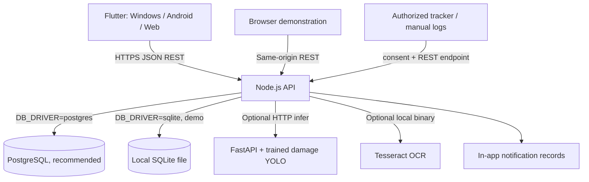

# Technical architecture

### Logical components

- `api/routes.js`: endpoint routing, validation, RBAC, payment rules, reservation lifecycle, QR token generation/verification, consent and photo processing.
- `api/db.js`: async query adapter with SQLite and PostgreSQL transactions, qmark placeholder conversion.
- `api/smart.js`: algorithms with transparent labels (ridge regression, basic demand trend, ranking, anomaly signals, haversine geofence, OCR parsers).
- `api/security.js`: salted scrypt password hashes, cryptographic bearer tokens hashed in DB.
- `api/server.js`: Node native HTTP server + live browser demo. **This is the tested zero-dependency runtime.**
- `api/express-server.js`: Express 5 transport with same request handler; requires `npm install` and is not verified in this environment.
- `sql/postgres.sql`: btree_gist-powered EXCLUDE constraint prevents concurrent same-car date collisions at DB level.
- `flutter_app/lib`: Material3 responsive UI with action forms.

### Security boundaries

Only `/api/health`, `/api/features`, and `/api/auth/login` are public; remaining APIs require bearer login. Generating a handover code requires a confirmed booking and recorded pickup inspection. Only hashes persist; possession of the code and authorized API login are needed to activate handover. Tokens are single-use and expire after 24h. GPS logging records source and requires explicit authorization flag, but this prototype does not enforce tracker-device signatures; a real deployment needs device identity and role separation. OCR/damage processing should use privacy-protecting image retention controls.

### Booking constraints

The booking period is `[pickup_date, return_date)`, so vehicle A returned on Nov 5 can be booked again starting Nov 5. SQLite routes check collision inside `BEGIN IMMEDIATE` transaction. PostgreSQL enforces non-overlap using `EXCLUDE USING gist` for non-cancelled pending/confirmed/active bookings. Maintenance state blocks new reservations. Booking status is `pending → confirmed → active → completed` or `cancelled` before pickup. Confirmed → active requires pickup inspection plus verified QR handover. Active → completed requires recorded return inspection and a settled balance. The workflow summary endpoint is a read-only projection of bookings, inspections and payments.

### ML notes

Dynamic pricing uses regularized least squares over same-category historical rates and features (`weekend`, `demand index`). If category has fewer than eight completed records it falls back to labelled rules. The seeded historical rentals are synthetic; coefficient quality cannot be claimed from these demos. The demand forecast is a monthly least-squares trend baseline or historical average fallback. Fraud detection is explainable threshold heuristics + optional z-score and must never be represented as fraud proof. Maintenance alerts are rules; damage inference requires separately trained weights.
